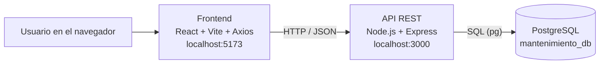
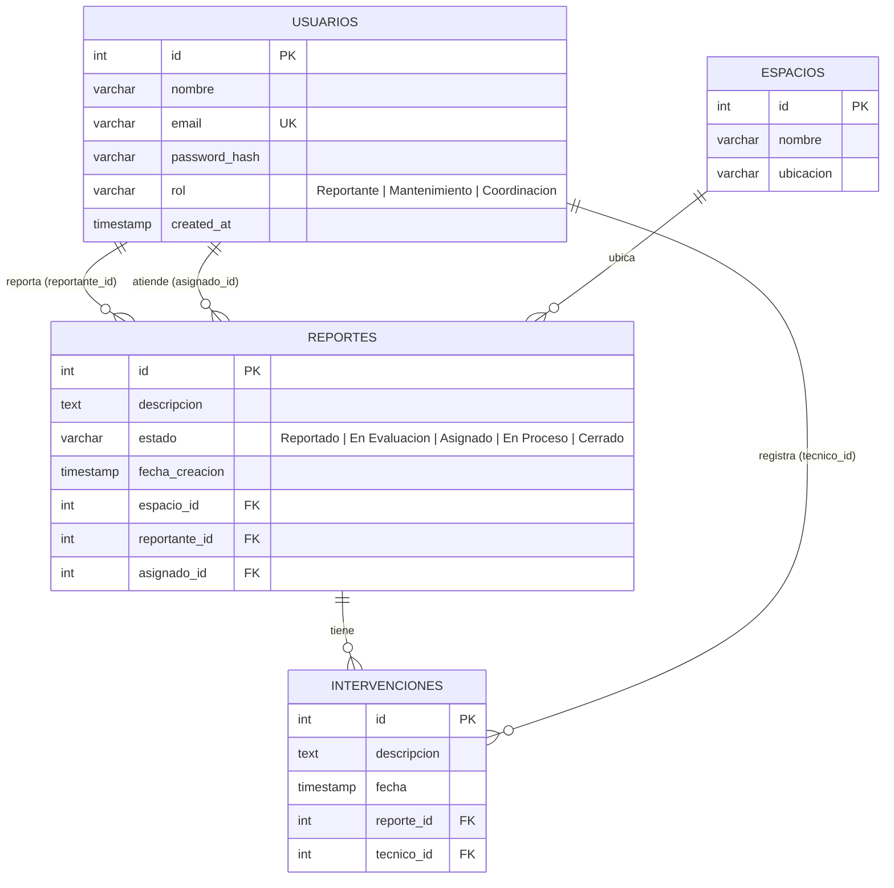
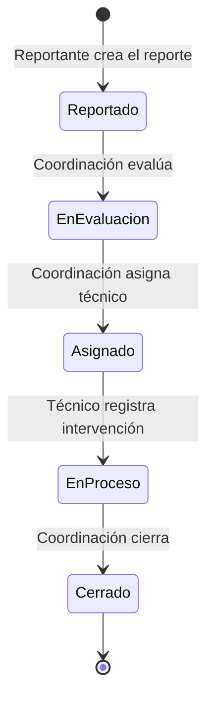

# Diseño de la aplicación y los servicios web

Proyecto Final 05 - Gestión de mantenimiento de instalaciones.

## 1. Arquitectura

El sistema usa una arquitectura cliente-servidor de tres capas. Cada capa se ejecuta por separado y solo se comunica con la siguiente.



| Capa | Tecnología | Responsabilidad |
|------|------------|-----------------|
| Interfaz | React, Vite, Axios, React Router | Mostrar pantallas por rol, enviar formularios y consumir la API |
| Servicios | Node.js, Express, bcryptjs, cors | Exponer la API REST, aplicar reglas de negocio y cifrar contraseñas |
| Información | PostgreSQL | Guardar usuarios, espacios, reportes e intervenciones |

Estructura de carpetas:

- `frontend/src/pages`: `Login`, `DashboardReportante`, `DashboardMantenimiento`, `DashboardCoordinacion`.
- `frontend/src/services/api.js`: cliente Axios con la dirección base de la API.
- `backend/src/routes`: `auth.routes.js`, `reportes.routes.js`, `intervenciones.routes.js`.
- `backend/src/db/pool.js`: conexión a PostgreSQL con variables de entorno.
- `database/schema.sql` y `database/seed.sql`: estructura y datos de prueba.

## 2. Actores y responsabilidades

| Actor | Rol en el sistema | Qué hace |
|-------|-------------------|----------|
| Reportante | `Reportante` | Registra fallas y consulta sus propios reportes |
| Personal de mantenimiento | `Mantenimiento` | Consulta los reportes que le asignaron y registra intervenciones |
| Coordinación | `Coordinacion` | Consulta todos los reportes, los evalúa, asigna técnico y cierra |

## 3. Modelo de datos



Restricciones en la base de datos:

- `usuarios.email` es único y `usuarios.rol` solo admite los tres valores del modelo.
- `reportes.estado` solo admite los cinco estados y por defecto es `Reportado`.
- Si se elimina un reporte, se eliminan sus intervenciones (`ON DELETE CASCADE`).
- Si se elimina el usuario asignado, `asignado_id` queda en `NULL`.

## 4. Ciclo de vida de un reporte



Regla de negocio: el estado solo avanza al siguiente de la lista y un reporte `Cerrado` no admite más cambios. El servidor lo valida en `PATCH /api/reportes/:id/estado` y responde 400 si la transición no está permitida.

## 5. Especificación de la API REST

Dirección base: `http://localhost:3000`. Todas las peticiones y respuestas usan JSON.

| Método | Ruta | Descripción | Condición de aceptación |
|--------|------|-------------|-------------------------|
| POST | `/api/auth/register` | Registra un usuario con la contraseña cifrada | Apoyo a todas |
| POST | `/api/auth/login` | Inicia sesión y devuelve los datos públicos del usuario | Apoyo a todas |
| GET | `/api/auth/tecnicos` | Lista los usuarios con rol `Mantenimiento` | CA-03 |
| POST | `/api/reportes` | Crea un reporte en estado `Reportado` | CA-01 |
| GET | `/api/reportes` | Lista todos los reportes, del más reciente al más antiguo | CA-06 |
| PATCH | `/api/reportes/:id/estado` | Cambia el estado si la transición es válida | CA-02, CA-05 |
| PATCH | `/api/reportes/:id/asignar` | Asigna un técnico y deja el reporte en `Asignado` | CA-03 |
| POST | `/api/intervenciones` | Registra una intervención y pasa el reporte a `En Proceso` | CA-04 |

### POST /api/auth/login

Entrada:

```json
{ "email": "coordinador@test.com", "password": "123456" }
```

Respuestas:

- 200: `{ "mensaje": "Login exitoso", "usuario": { "id": 3, "nombre": "...", "email": "...", "rol": "Coordinacion" } }`
- 401: `{ "error": "Credenciales inválidas" }`

### POST /api/reportes

Entrada:

```json
{ "descripcion": "Falla en la iluminación del Aula 101", "espacio_id": 1, "reportante_id": 1 }
```

Respuestas:

- 201: el reporte creado, con `estado` igual a `Reportado`.
- 500: `{ "error": "Error al crear reporte" }`

### PATCH /api/reportes/:id/estado

Entrada:

```json
{ "nuevo_estado": "En Evaluacion" }
```

Respuestas:

- 200: el reporte actualizado.
- 400: `{ "error": "Transición no permitida de \"Reportado\" a \"Cerrado\"" }`
- 404: `{ "error": "Reporte no encontrado" }`

### PATCH /api/reportes/:id/asignar

Entrada:

```json
{ "asignado_id": 2 }
```

Respuesta 200: el reporte con `asignado_id` igual a 2 y `estado` igual a `Asignado`.

### POST /api/intervenciones

Entrada:

```json
{ "descripcion": "Se cambió la lámpara", "reporte_id": 1, "tecnico_id": 2 }
```

Respuesta 201: la intervención creada. El reporte pasa a `En Proceso`.

## 6. Diseño de la interfaz

| Pantalla | Ruta | Contenido |
|----------|------|-----------|
| Inicio de sesión | `/` | Correo y contraseña. Al entrar redirige a `/dashboard` |
| Reportante | `/dashboard` | Formulario de nueva falla (descripción y espacio) y tabla con sus reportes y su estado |
| Mantenimiento | `/dashboard` | Tabla con los reportes asignados al técnico y botón para registrar intervención |
| Coordinación | `/dashboard` | Tabla con todos los reportes, botones Evaluar y Cerrar, y selector de técnico para asignar |

La ruta `/dashboard` muestra una pantalla distinta según el rol guardado en la sesión. Si no hay sesión, redirige a `/`.

Los botones de cada acción solo aparecen cuando el estado del reporte lo permite. Por ejemplo, `Cerrar` solo se muestra en reportes `En Proceso`.

## 7. Validaciones y reglas de negocio

| Regla | Dónde se aplica |
|-------|-----------------|
| La contraseña se guarda cifrada con bcrypt y nunca se devuelve | Servidor |
| El estado solo avanza en el orden definido y `Cerrado` es final | Servidor (400) |
| Un reporte inexistente al cambiar estado devuelve 404 | Servidor |
| La descripción del reporte es obligatoria | Interfaz y base de datos (`NOT NULL`) |
| Cada rol ve solo sus acciones y los reportes que le corresponden | Interfaz |
| Un reporte siempre pertenece a un espacio y a un reportante | Base de datos (llaves foráneas) |
